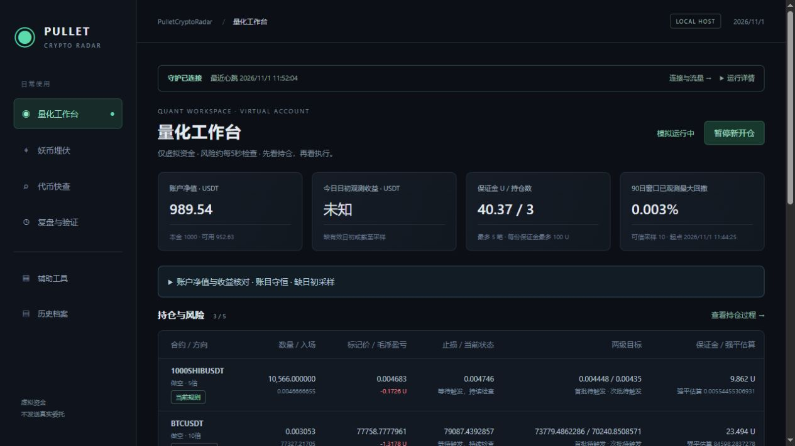
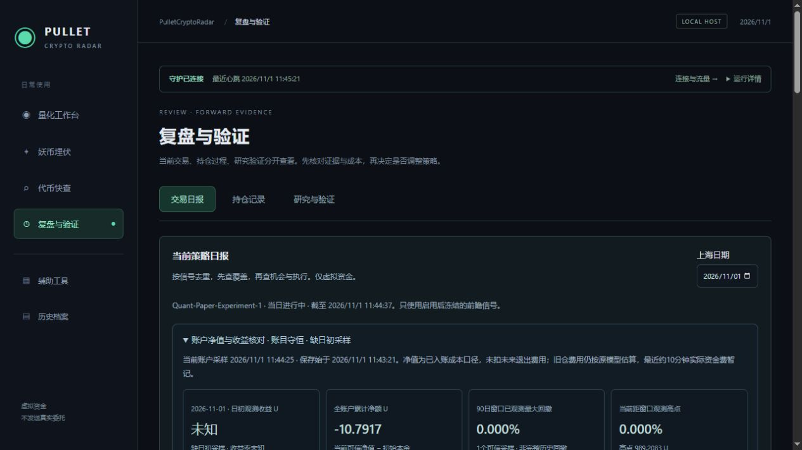

# Paper-Performance-1 账户净值、日收益与回撤核对

2026-11-01，上海时间。接入[量化工作台](http://localhost:5218/)和[复盘与验证](http://localhost:5218/journal)，四个主入口保持。只增加模拟账户的观测与核对，不修改信号、杠杆、仓位、止损止盈或资金费结算规则，不新增外部请求。

## 净值与账目

每个上海分钟内首个完成的账本轮次保存净值；开仓、数量变化、平仓和实际资金费入账另存当轮采样。样本和账户/成交共用SQLite事务，按账户Revision唯一插入，提交失败时全部回滚。采样保存现金、原/剩余保证金、逐仓标记价与来源时间、浮盈亏、估值调整、规则贡献和核对结果，不依赖会截断的旧滚动Curve。

净值 = 现金 + 剩余保证金 + 标记毛浮盈亏 + 旧模型估值调整。旧模型按原规则对仓位估值作零下限，调整项明确列出；新模型保留负估值，不人为封亏。开仓手续费已扣现金，已入账资金费反映在保证金/现金中，不再重复扣除，未含未来退出费用。

另核对：初始本金 + 全部已结算净额 − 已平部分迟到资金费 + 未平仓贡献 = 当前净值，允许差额不超过0.00000001U。未平仓贡献为仓位估值减剩余原保证金和未分摊开仓费，避免分批后重复归属费用。使用完整成交/资金费账本，既不截断为RecentTrades，也不以最终退出标记代替完整交易胜负。

账户超过30秒未更新、逐仓已提交标记/报价超过45秒、来源时间无效、新模型资金费窗口未核对、资金费无法归属或账目不守恒时，可信净值为未知，并显示原因。旧仓保留估算费用，新模型最近约10分钟资金费仍暂记；通过观察窗口不代表真实交易所无遗漏。

旧规则、当前启用参数哈希及生效后规则、其他规则分别展示已结算净额与未平仓贡献，合计核对全账户变化。费用列是贡献内的费用，不能再扣一次；分组没有独立本金，不计算虚构的子账户收益率。

## 每日收益与回撤

上海日边界采用零点后60秒内首个保存采样，结束的日期采用下一零点同样口径；实际起止时刻与偏移可见，不伪称精确零点。固定选择首个采样，无效时不挑后续较有利净值替代。当天以当前已提交账户估值作截至点。

日净额 = 有效截至净值 − 有效日初观测净值；日初为正才计算区间收益率。缺日初、缺日末、失鲜或未核对资料保留未知。非正日初仍可显示金额差，收益率未知。中途启动不把启动净值冒充当天零点净值。

采样从11:43:21开始，因此11月1日的完整日收益未知。旧Curve和旧持仓观察缺少这一版核对契约，不导入为可信日初。11月2日零点若能取得有效首样，即可按实际时间开始展示日初观测收益；采集失败或第一样无效仍如实保持未知。

回撤只按最近90日窗口的保存采样及当前账户截面计算，展示实际起点、样本数、高点/低点时刻、无效样本和超过125秒的间隔。当前回撤需当前估值有效；窗口最大回撤仅为已观测下界，不是账户自建立以来的完整最大回撤。没有可信样本时未知，不能拿初始本金1000虚造一个观测高点。有效历史采样不因同一账户Revision后来停更而失效，只有当前估值失效。

新增收集前的当日区间也属于未观测范围；长间隔不直接等于服务器停机。首次发布后的旧报价失鲜样本原样保留，后续正常取得可信采样，不删除不利或无效记录。单个可信点的0%只表示这批采样尚未观测到回落。

## API、保存与部署

新增只读`GET /api/paper/performance?date=yyyy-MM-dd`，允许最近60天及今天，格式错误、未来或过早日期返回400。历史索引/日期样本最多缓存60秒，当前估值每次从一致的已提交账户和全账本重新核对。历史日期只改变日收益区间，“当前账户”和90日窗口仍按报告生成时间显示，时间明确列出。

现有后台日报增加可选AccountPerformance，仍每5分钟保存今天和昨天；旧日报保持可读。业务库Schema15→16，仅增加PaperEquitySample表及Time索引；升级前正常停机、备份业务/行情数据库与配置。配置、原始成交/资金费、持仓ID/数量、现金、启用时间和参数哈希保持。月30GB预算保留，数据保存使用本机磁盘。

首版11:43:21发布，边界修正的最终发布与进程、备份位置以[运行核验](Account-Performance-Runtime-2026-11-01.json)为准。第二次发布用于保护同Revision的历史有效点，并核对真实重启前后的净值记录保留。守护与可见状态窗口继续使用原启动方式。

## 验证与证据

全量715项后端测试通过：Core96、Scanner100、Integration519，其中新增净值专项21项；前端43项、Vue类型检查及最终生产构建通过。最终TRX在`TestResults/PaperPerformance-2026-11-01/Final-Accepted/`。

覆盖：多空估值、已付费用不重复扣、旧仓估值下限、实际Quant入场归属、分批与迟到负资金费、缺记录不守恒、孤立费用、失鲜与未来时钟、上海边界/60秒排除、历史缺日末、非正净值、无样本未知、断档、22000个样本不随Curve截断、过期/未来排除、分钟和事件采样、事务回滚/重复版本、真实日报存档往返、缓存刷新，以及停更不改写历史有效点。

正式浏览器核对工作台未知日收益、净值和采样起点，日报逐仓构成、零差额及规则贡献；控制台无警告/错误。隔离内存样例显示1000→1020→990，日净额-10、-1%和最大回撤2.941%，只验证页面与公式，不作为策略样本；预览已关闭。

证据：[只读上线前核对](Account-Performance-Preflight-2026-11-01.json)、[正式绩效报告](Account-Performance-Report-2026-11-01.json)、[正式日报](Account-Performance-Daily-2026-11-01.json)、[原成交/资金费保持](Account-Performance-Preservation-2026-11-01.json)、[采样落库](Account-Performance-Storage-2026-11-01.json)、[浏览器记录](Account-Performance-Browser-2026-11-01.json)、[汇总验收](Account-Performance-Validation-2026-11-01.json)。

仍未完成：真实跨零点的前瞻日收益现场样本、长期账户回撤、更多自然分批/尾仓退出及30～60天策略评审。这轮到净值功能及发布验收结束，服务器继续采集和模拟，下一项为退出亏损归因。

