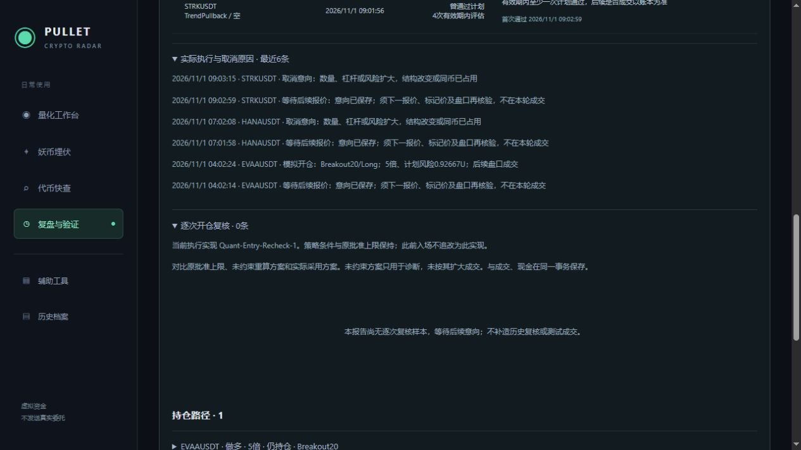

# Quant-Entry-Recheck-1 开仓复核验收

2026-11-01，上海时间。已部署到原模拟账户；查看[复盘与验证](http://localhost:5218/journal)中的“逐次开仓复核”。现有四个主入口保留，未新增导航。

## 修复与边界

原实现先根据后续行情自由重算仓位，再在数量、杠杆或风险超过原批准值时取消整个意向。已用确定性长、短样本复现：即使报价改善，自由重算也可能增加数量而使意向被取消。

现在先将原批准数量、杠杆、含成本风险作为上限，再按当前盘口、数量网格、保证金、组合余量和现金计算。结构止损取整必须与原批准一致；信号过期、身份、环境、OI、资金费覆盖、成本和后续报价检查继续有效。未约束方案仅用于诊断，成交采用受约束方案。原策略参数哈希与启用时间保持；执行实现单独标记为Quant-Entry-Recheck-1，已有EVAA不追标为此版本。

隔离测试示例：原批准数量0.991，自由重算1.043，实际采用0.991；原风险1.95589836U，自由重算1.95402007U，采用风险1.85660008U。该示例来自内存测试账户，未写入正式账户，也不证明任何真实策略收益。

## 留档和页面

每次意向创建、等待资料、过期/拒绝、成交及用户暂停取消均独立留档。保存原始意向和冻结规则、当前市场与环境、持仓风险和其他意向现金预留、盘口/合约规则、资金费覆盖，以及相关标的最近73根小时K线和小时/缺口标记（72小时相关性实际计算所需）。数量、杠杆、含成本风险、止损、保证金、入场费、可用现金有原批准/自由重算/实际采用三列；未核验项不显示为通过。

业务库升级到Schema15。摘要和完整原始资料分开保存，不把大段K线塞入账户接口。复核记录、成交、现金、资金费与审计在同一SQLite事务提交，重复ID/账户版本冲突整体回滚。用户暂停会同时保存每笔未成交意向的取消原因；已有仓位继续管理。

日报默认展示所选日最近200条，超限明确提示，完整记录仍保留在本地。展开一条可查实际检查失败项、报价/盘口来源时间及完整JSON。旧记录保持原样。

## 历史取消的证据限度

HANAUSDT 07:02:08、STRKUSDT 09:03:15的旧取消日志只保存合并原因，没有当次精确复核值。只读查询找到的最近先前影子方案与原批准方案相同，但它们早于取消时刻，不能替代执行复核，也不能据此认定两笔一定被本缺陷取消。详见[历史资料](Entry-Recheck-Historical-2026-11-01.json)、[只读存储核验](Entry-Recheck-Storage-2026-11-01.json)。没有重开这两个旧信号或改写原账本。

## 检查与部署

- 后端全量650项通过：Core96、Scanner100、Integration454，结果在`TestResults/EntryRecheck-2026-11-01/Final/`。随后增加用户暂停及较低原批准杠杆两项测试，最终相关回归89项全部通过，结果在`FinalChecks/`；未将增补后测试数量称为再次全量通过。
- 相关检查包括长/短数量上限、风险上限、原批准低杠杆、止损一致性、当前拥挤风险、现金预留、后续报价、资金费等待、过期、JSON输入重算、事务回滚、重启恢复、用户暂停及原有退出调度。
- 前端43项、Vue类型检查和生产构建通过。隔离只读预览核对正向展开和三列值；正式页核对空样本、版本说明与旧持仓，浏览器无警告/错误。预览服务器已关闭，测试账户未写入正式库。见[浏览器核验](Entry-Recheck-Browser-2026-11-01.json)、[隔离示例截图](Entry-Recheck-Fixture-2026-11-01.png)。
- 09:54:02首次上线，10:01:17补齐用户暂停取消留档后完成发布。迁移前业务库及配置备份在`artifacts/migration-backup/EntryRecheck-20261101-095400/`，发布记录在`artifacts/entry-recheck-publish-manifest.json`。原配置SHA256保持，月30GB及原代理设置保留。

10:05:23运行核验：Ready，进程38996，模拟启用中；现金约961.663946U，BTC/NMR/EVAA三笔ID与精确数量、原启用时间和规则哈希保持。五个原始研究/迁移档案SHA256均不变，历史迁移报告仍只读。见[运行证据](Entry-Recheck-Runtime-2026-11-01.json)。

此时正式账户复核记录0条，尚无新意向触发；页面如实留空，未用隔离测试冒充现场成交。EVAA仍持有、无退出腿，首笔分批/退出和最终费用全生命周期尚待自然行情，30～60天前瞻盈利验证仍未完成。

