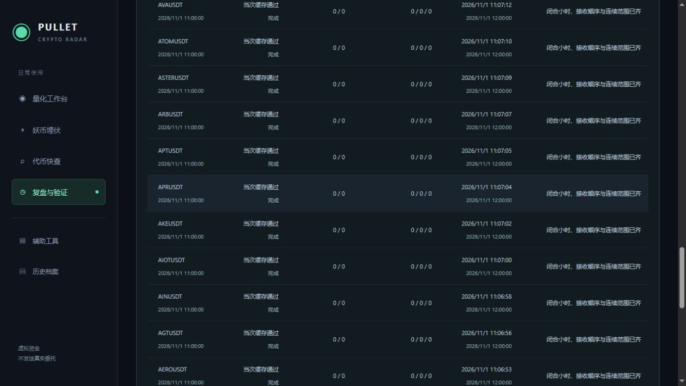
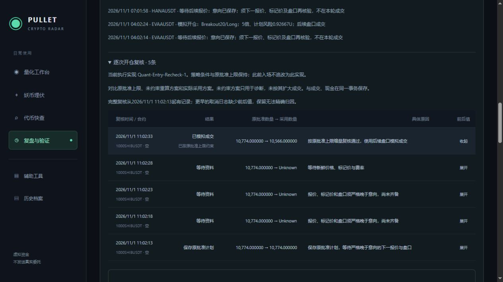

# Execution-Quality-1 数据与退出质量验收

2026-11-01，上海时间。11:09:42完成最终发布，Ready，进程21448，守护及可见状态窗口正常恢复。本轮交付APR补数核验、可追踪的补数阶段/重试，以及后续退出的本机时间记录；保留四个主入口。

## APR与补数跟踪

APR此前10月29日16点小时K线的接收时间早于来源时间7毫秒。它已在11点正常补数周期中重新获得有效资料；本轮新版跟踪上线前的只读缓存核验已无缺口，不能把11:07的缓存通过冒充重新下载的时刻。见[上线前基线](Execution-Quality-Baseline-Before-2026-11-01.json)、[上线后基线](Execution-Quality-Baseline-After-2026-11-01.json)。

新增Hourly-Warmup-Audit-1本地记录，保存每币检查小时、开始/更新时间、下次检查时间、阶段、缺口与不合格行、请求上限/返回/接受数量及原因。阶段包括缓存、历史请求、历史保存、OI、报价、复查和完成。落库后重新读取的结果决定缓存通过；其他阶段报错保留阶段和异常类型。Ready只表示当次小时缓存通过，不表示所有市场资料齐全或允许交易。

失败/缺资料/未完成尝试跨重启保留，到期重试标的暂离轮换池也继续纳入，每轮最多额外20个重试标的。既有优先币列表明确纳入小时补数，避免只因轮换暂离而无人检查。使用原限速和网络计量，不绕过30GB月预算；缓存齐全时不重新下载K线。旧调度没有逐币持久尝试记录，因此不声称已经精确还原APR此前每一次为何没有成功补齐。

复盘页新增折叠“当前补数进度与重试”；打开后每30秒只读本地接口`/api/quant/warmup`。APR记录11:07:04检查完成、缺口0/不合格0、请求/返回/接受均0（缓存已有有效资料），下次检查12:00。最终发布重启后开始/更新时间和下次时间保持，证明没有抹掉调度状态。

## 退出时序

新触发保存Quant-Exit-Timing-1：触发原因与价、当时止损、来源/本机接收时刻、实际本机引擎判定时刻、前一报价来源时刻；生成退出腿时再记录实际本机结算计算时刻。生产调用使用TimeProvider分别采样，不用同一个行情快照时间冒充全部步骤。账本业务成交时间与原判定规则仍沿用原轮次资料时点。

只计算同一本机时钟下的接收→判定、判定→计算、盘口接收→计算，标明判定时盘口是否已在缓存。锁定退出等待或部分成交保持原触发记录；目标批次完成后清除，下一次独立触发重新记时。止损覆盖未完成目标时采用新的风险触发记录。未接持久化确认耗时，不声称测到完整磁盘提交或真实交易所撮合延迟。

来源与本机可能有时钟偏差，不用二者相减估计网络延迟。旧EVAA只有历史触发界限、盘口接收和账本轮次时点；页面明确“旧交易缺少本轮判定时间”，接收→判定/判定→计算保持Unknown。保留盘口接收至旧账本轮次约5796.9ms作为部分资料，不能据此将全部价差归因于程序。旧成交原始JSON发布前后完全一致。

目前新退出计时尚无生产触发样本。隔离TESTUSDT两目标及最终退出验证了正向显示，单元测试另外验证真实本机采样与业务轮次不同、等待/部分成交累计耗时、较后目标/止损重置及异常本机时间不产生负耗时。隔离资料不写正式账户。没有据单笔损失调整报价频率或风险参数，后续应根据真实计时分布及实测流量判断是否调整。

## 首笔逐次复核实际成交

1000SHIBUSDT于11:02:13保存意向，经两次等待后续报价、一次等待新鲜价格/标记价/费率，11:02:33.716782模拟做空成交。原批准10774、自由重算10658、实际采用10566；杠杆5，原风险0.9813012881455U、采用0.9623565445095U，结构止损0.004746保持。保证金9.8615975346U，入场费0.0246539938365U。

原始信号复算、后续盘口、现金与其他预留均留档，5条复核记录在日报可展开；这是Quant-Entry-Recheck-1首笔生产成交样本。它证明受限方案按资料成交和保存，不证明这笔在旧代码下一定被取消（自由重算本身也低于原批准）。本笔仍持仓，无最终收益；最初10分钟资金费补证显示Unknown，继续保留原限制，不填零放行其他新仓。

## 核验

后端最终全量681项通过：Core96、Scanner100、Integration485；前端43项、最终Vue类型检查与生产构建通过。结果在`TestResults/ExecutionQuality-2026-11-01/Accepted/`。测试覆盖补数阶段计数和重启/到期重试、旧尝试不能覆盖新尝试、哈希文件名、长短触发、首次观察锁定、部分减仓、目标完成清除及真实本机两次时钟采样。

发布核对现金约952.625652175272U，BTC/NMR/1000SHIB三笔ID及精确数量、原控制参数和启用时间保持。现金已扣新仓保证金和入场费，不将保证金占用解释成亏损。五份更早研究/迁移文件、121份10点冻结输入/判断及EVAA原成交保持。配置摘要仍为`8793C20D598AF77C3AC254B5F7D74253B550FEA46C7C5FEB25493A4194626CCE`，未迁移数据库结构。

见[运行核验](Execution-Quality-Runtime-2026-11-01.json)、[验收摘要](Execution-Quality-Validation-2026-11-01.json)、[补数记录](Execution-Quality-Warmup-2026-11-01.json)、[首笔复核原始资料](Execution-Quality-First-Recheck-2026-11-01.json)、[浏览器记录](Execution-Quality-Browser-2026-11-01.json)。正式页及隔离页无浏览器警告/错误，预览已关闭。实际分批/尾仓、新计时现场样本及30～60天盈利验证继续等待自然行情，本轮开发和发布核验完成后停止，服务器继续采集与模拟执行。

