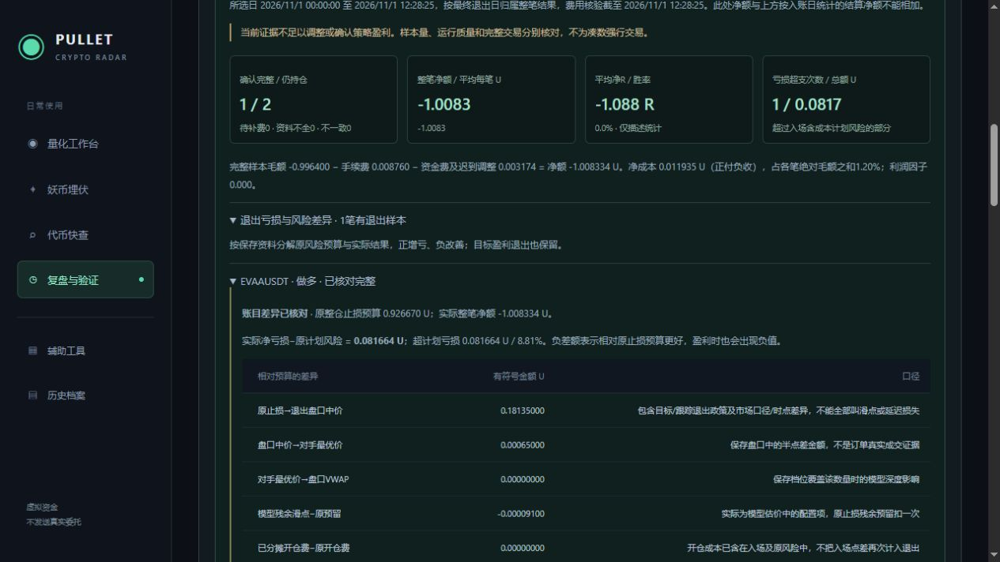
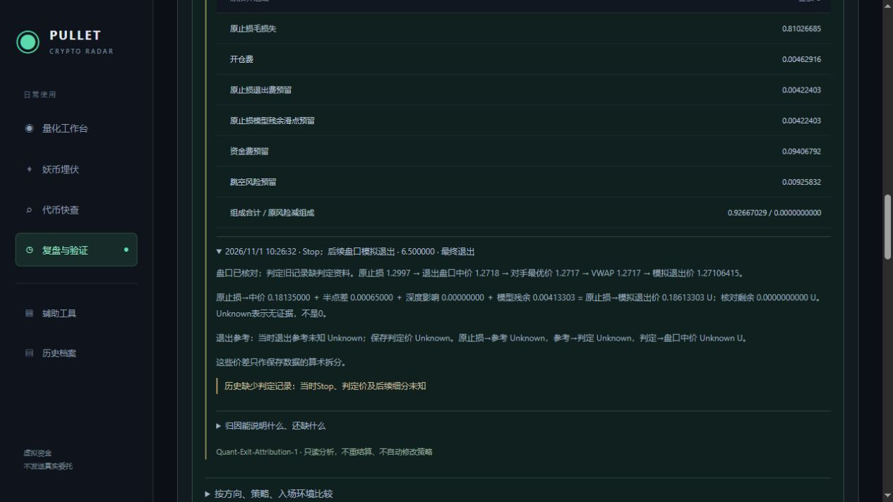

# Quant-Exit-Attribution-1 退出风险差异与价格成本桥接

2026-11-01上海时间12:27:11发布，进程58040，Ready。入口为[复盘与验证](http://localhost:5218/journal) → 完整交易评审 → “退出亏损与风险差异”。复用日/周选择和逐笔记录，不增加主导航、供应方请求或真实委托。原策略、风险、止损止盈和实际资金费结算代码未修改。

## 先核对原预算，再核对实际差额

使用成交时保存的QuantPlan、EntryQuote、原参数和成本版本：

原风险 = 原止损毛损失 + 开仓费 + 原止损退出费预留 + 原止损模型残余滑点预留 + 资金费预留 + 跳空风险预留。

原入场成本数量/价格、取整止损、手续费及含成本损失须与此组成一致。参数或模型版本未知时不套当前配置补算；不一致时标记核对失败。此处原风险指实际模拟成交时采用的计划，不是更早申请的较大批准数量/风险。

完整交易的有符号差额 = 实际净亏损 − 原风险。正值表示相对预算增亏，负值表示改善；超计划亏损只在最终总差额上取max(0,差额)。仍持仓、数量不完整、资金费未覆盖最终退出或账目不一致时不确认整笔差额。

保存的盘口完整时，差额桥接为：原止损至退出盘口中价差 + 半点差 + 盘口深度影响 + 模型残余减原残余预留 + 开仓费差额 + 退出费差额 + 实际资金费减原预留 − 原跳空风险预留。保持每项正负号，不能只加正项。预留减少不是实际收入。

盘口缺失时只展示能够核对的账本合计价差，不把点差、深度或残余补成0。保存档位、方向、数量、VWAP、模型估价和费用互相矛盾时标记不一致。原始成交ID相同的相同资料只计一次，冲突记录不确认整笔。无额外资金费重结算或历史账目改写。

## 价格细分的解释范围

逐腿核对原止损→退出中价→对手最优价→保存盘口VWAP→模拟估价。已有判定记录时，再展示原止损→保存的退出参考→判定价→退出盘口中价：Stop使用保存的当时止损，Target1/2使用原目标，到期/风险退出明确使用当时判定参考价/标记价，不伪装为交易所实际强平价。

原止损到中价包含目标与跟踪退出的政策差异。盈利分批及尾仓也展示，不能把其全部价差叫做滑点。新判定记录必须核对版本、原因、来源界限及本机时序；缺失或无效时细分未知。锁定一次判定可能对应多次盘口执行，不能当作多次独立首次穿越。

这些都是保存价格的算术关系，不证明网络、程序等待、首次穿越或某种操盘行为造成了同额损失。时间间隔在已有生命周期核对区另列，不以来源/本机时钟相减推算网络耗时；QuoteGap只表示期间曾观察到报价间隔，不证明它造成这次超损。

## EVAA现场结果

原风险0.92667029498993265U，最终净额-1.008334411345U；有符号差额及超计划亏损0.08166411635506735U，约8.81264%。

| 相对原风险的差异 | U |
|---|---:|
| 原止损1.2997→退出盘口中价1.2718 | +0.181350000000 |
| 中价→卖出可用的最优买价（买一）1.2717 | +0.000650000000 |
| 深度影响 | 0 |
| 模型残余减原预留 | -0.000091000000 |
| 开仓费差额 | 0 |
| 退出费减原预留 | -0.000093066513 |
| 实际资金费减原预留 | -0.090893500287 |
| 减原跳空风险预留 | -0.009258316845 |
| 合计 | +0.081664116355 |

逐腿原止损到模拟退出价差0.186133025U中，保存盘口深度可覆盖全部6.5个代币；模型残余为0.004133025U。减去原预算对应预留后才得到上表差异，不能把0.186133025和0.081664116355重复相加。

原预算分解和总桥接剩余约4×10^-28U，属于十进制末位舍入，在原核对相对容差10^-18内。页面按显示精度为0，原始JSON保留精确数值。

EVAA没有当时判定记录，不能确定当时Stop是否与原止损相同、首次穿越时刻、触发前后各占多少或更快处理能否减少同额亏损。因此本轮结论是“价格/成本差异可核对、细分因果未知”，没有修改交易阈值或凭一笔亏损重新调参。

## 数据保持、运行与测试

发布正常停机并备份业务/行情数据库和配置。Schema16保持，无结构迁移；现金、BTC/NMR/1000SHIB/AIOT四笔持仓的精确ID和数量、启用时间、规则哈希、配置保持。AIOTUSDT于12:03:16按原冻结策略自然做多58，计划风险约0.480275U，本轮归因代码未参与开仓。

原成交与资金费Payload逐字节SHA256一致，45份发布前净值采样逐项哈希保持，5份较早研究/迁移档案和121份10点冻结资料保持。旧文件仍可读，归因是日报里的可选派生字段，后台沿用每5分钟保存今天/昨天的日报。流量预算仍为每月30GB。

全量后端738项通过：Core96、Scanner100、Integration542；其中归因专项23项。前端43项、Vue类型检查、生产构建通过。TRX在`TestResults/ExitAttribution-2026-11-01/Final/`。覆盖多空预算/差额守恒、盘口分层、旧/无效判定未知、缺VWAP退回合计、交叉/深度不足/VWAP/方向矛盾、原预算不符、未来模型不补算、未平/待费/缺退出资料、分批与跟踪政策、迟到正负费用幂等、重复/冲突、到期与风险参考、等待/有限深度多腿以及序列化/日报投影只读。

隔离内存样例通过真实模拟引擎生成三腿退出，页面保留盈利交易的负差额、0超损及3腿判定记录，不作为自然成交或盈利证据。专项尾仓测试另设已收紧的止损作为输入来检验归因，不能当作策略跟踪逻辑的独立验证。正式页面核对EVAA原预算、8.81%超损、原盘口和未知判定，并验证日/周切换；控制台无警告/错误，隔离预览已关闭。

证据：[上线前只读核对](Exit-Attribution-Preflight-2026-11-01.json)、[正式日报](Exit-Attribution-Daily-2026-11-01.json)、[运行与原账户保持](Exit-Attribution-Runtime-2026-11-01.json)、[原成交/资金费Payload保持](Exit-Attribution-Preservation-2026-11-01.json)、[浏览器](Exit-Attribution-Browser-2026-11-01.json)、[汇总验收](Exit-Attribution-Validation-2026-11-01.json)。

仍需：更多自然退出、实际分批/尾仓与完整判定样本，完整市场条件下五仓资金/组合约束验证，以及30～60天前瞻策略评审。现在完整新模型交易仍只有EVAA一笔，不能据此判断策略有效。本轮开发到发布验收结束，服务器继续运行。

