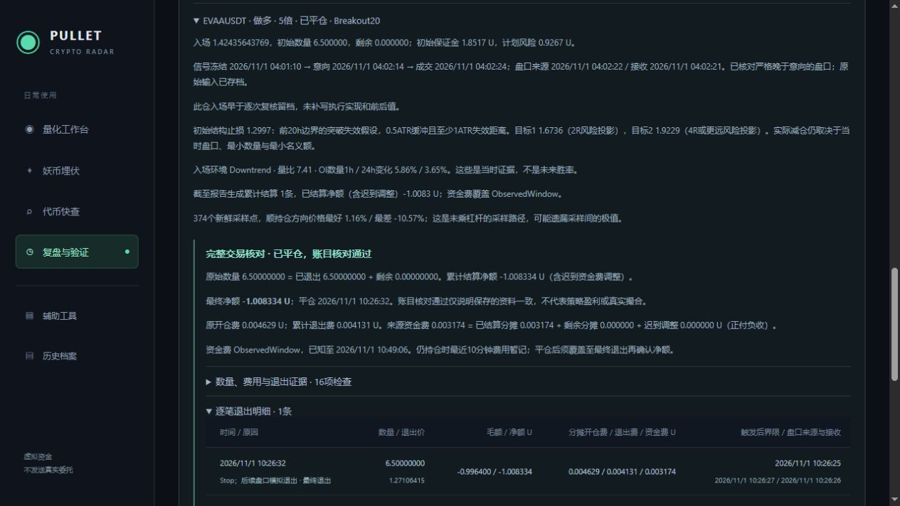

# EVAA首笔自然退出复盘

2026-11-01，上海时间。EVAAUSDT于04:02:24.8357323按Breakout20多头方案模拟入场，10:26:32.4607123由原止损调度自动平仓。没有人为平仓、补本金或改价。此笔入场早于逐次开仓复核留档，不追标为Quant-Entry-Recheck-1。

| 项目 | 保存值 |
|---|---:|
| 数量 | 6.5，全部退出，剩余0 |
| 杠杆 / 初始保证金 | 5倍 / 1.851663369 U |
| 入场价 | 1.4243564376923077 |
| 初始止损 | 1.2997 |
| 退出盘口VWAP / 加模型滑点后的价 | 1.2717 / 1.27106415 |
| 毛盈亏 | -0.99639987 U |
| 开仓费 / 退出费 | 0.0046291584225 / 0.0041309584875 U |
| 实际已观察资金费 | 0.003174424435 U |
| 最终净额 | **-1.008334411345 U** |
| 原含成本计划风险 | 0.92667029498993265 U |
| 超过计划风险 | 0.08166411635506735 U，约8.81% |

这笔净亏损相当于1000U初始本金约0.100833%，不是账户当天总收益率；仍有原BTC/NMR持仓及旧损益。保证金不是最大可能亏损上限，计划风险也不是保证的封顶。

## 退出证据与风险偏差

保存的触发后界限为10:26:25.144；退出盘口来源10:26:27.542、接收10:26:26.6637974，均严格晚于触发且早于结算。源端与本机时钟存在偏差，因此来源时间晚于本机接收约0.878秒不解释为负网络耗时。原执行检查及本次核对均使用各自保存时刻，没有调整时间戳。

10:25:47的分钟观察价为1.3064，高于止损；退出上下文保存10:26:25.144来源报价1.2738，已经低于止损。随后实际盘口VWAP为1.2717，模拟价再扣配置残余滑点。按初始止损价计算的纯价格损失参考是0.810266845U；盘口低于初始止损增加0.182U价格损失，配置残余滑点再增加0.004133025U，合计毛损失0.99639987U。再扣双边费用与实际资金费得到净额。

这说明实际盘口越过计划止损后，损失可超过原含成本风险；不能回填1.2997冒充可成交价。现有一分钟观察不记录每次价格变化，无法精确判定首次穿越时刻，也不能将0.182U全部归因于程序延迟或全部归因于市场跳空。QuoteGap=false仅表示未满足代码的报价断档标记，不代表逐笔全程无遗漏。

本轮不据这一笔扩大或收紧策略参数。已记录“下行环境中的多头突破失败”和风险超支，继续按冻结参数积累同方向/同环境的前瞻对照；若后续重复出现，应另立版本研究报价频率、退出延迟及缺口风险额度，不把未验证的调整回写到旧交易。

## 完整交易核对

生命周期状态Complete，16项检查全部通过；原始6.5=退出6.5+剩余0，保证金和开仓费分摊、逐腿毛净额、资金费分配及后续盘口一致。资金费ObservedWindow已知范围覆盖最终退出，最终净额可以按已观察来源确认；后续若出现迟到来源仍独立调整，不追改原成交。

首笔自然退出的账本链路已获得现场样本，但没有触发目标1/2，实际分批与尾仓现场验证仍待后续行情。只有一笔完整新模型交易，不能据0%胜率或一次止损判定长期正负期望。

原始资料：[日报](First-Exit-Report-2026-11-01.json)、[原账户与退出盘口](First-Exit-Account-2026-11-01.json)、[最近观察](First-Exit-Observations-2026-11-01.json)、[精确十进制计算](First-Exit-Audit-2026-11-01.json)。

