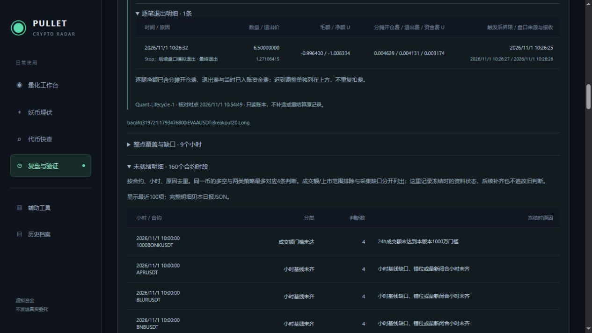

# Hourly-Warmup-2 补数修复验收

2026-11-01，上海时间。10:30:47发布并恢复守护/可见状态窗口，服务进程53996，Ready。当前四个主入口保持，复盘新增折叠的“未就绪明细”。本轮不改策略条件、风险参数、账户本金或历史判断。

## 实际问题

只读核查发现BLUR、MAGMA、Q、NMR、APR、ETHFI六个标的缓存含接收时间早于来源时间约7～45毫秒的小时K线，涉及2026-10-29的闭合小时。量化分析器正确拒绝这些资料；原补数逻辑只检查根数、首尾和连续性，800根看似齐全便跳过，因此拒绝可持续多小时。

现在补数计划核对身份、小时周期与对齐、闭合来源时间、有效价格、接收顺序/可见时刻及冲突值。识别到不合格记录后重新请求足以覆盖最早缺口的来源数据，通过同样检验才落库，写入确认后重新检查。完整缓存不下载；仅缺新闭合小时通常拉2根；本次旧不合格小时一般拉66～68根，物理内部缺口/无基线才拉最多800根。沿用原限速、网络计量与30GB月预算，未手工绕过预算请求。

缺口仍存在时保持未就绪并按调度重试；未上市之前的历史不会凭空补出。未更改原接收时间，不接受当前小时或未来资料，不重开已取消旧信号。

## 日报与分类

新增InputIssues，按冻结合约/小时/原因去重，保留判断数和原文。每币多空×两策略通常四条判断，不误报为四个币。小时基线缺口、报价时间、字段缺失、成交额门槛、上市范围等分开列出。UI最近100项、完整明细在日报JSON；旧Insufficient状态兼容保留，改用“未就绪判断”表述。

10点冻结时共有60币/240判断，其中17个币未就绪：9个基线问题、8个成交额门槛。旧快照仍保留当时状态；之后缓存补齐不能伪装成10点已齐。发布前后121份10点冻结判断/范围/原始输入SHA256全部一致，见[不可变文件核对](Baseline-Frozen-Verification-2026-11-01.json)。

## 测试与运行

后端全量673项通过：Core96、Scanner100、Integration477；前端43项、Vue类型检查和构建通过。结果在`TestResults/HourlyWarmup-2026-11-01/Final/`。新增回归覆盖满800根内坏接收时间、仅补新小时、物理缺口、错身份/周期/未来/非闭合资料与冲突、范围外无效行、重新获取后缓存恢复而冻结原始输入不变，以及四判断按一合约时段分类。

10:53只读核验当前60个标的中59个已通过337小时价格基线。先前六个故障标的中的五个已通过；ETHFI当时不在最新60池内，另从较早冻结资料取得身份后单独核对缓存，已确认修复。APR仍有一根坏记录，保持待补，未宣布全池资料齐全。详见[修复前](Baseline-Audit-Before-2026-11-01.json)、[修复后](Baseline-Audit-After-2026-11-01.json)、[60池加ETHFI补充核查](Baseline-Audit-Final-2026-11-01.json)。当前名单按轮换变化，不把不在池中当作数据已齐。

发布前快照已包含10:26:32自然退出的EVAA。发布核对BTC/NMR两笔ID/数量和现金962.5119037037085U一致，控制参数、原启用时间、五份更早研究/迁移档案及121份10点冻结文件保持；配置SHA256保持`8793C20D598AF77C3AC254B5F7D74253B550FEA46C7C5FEB25493A4194626CCE`。业务库Schema15未迁移。详见[运行核验](Hourly-Warmup-Runtime-2026-11-01.json)、[日报](Hourly-Warmup-Report-2026-11-01.json)、[浏览器检查](Hourly-Warmup-Browser-2026-11-01.json)。浏览器无警告/错误。

未完成项：APR来源缺口需后续调度继续核对；新复核实现尚无新意向成交样本；分批和尾仓仍缺现场样本；30～60天盈利验证尚未完成。首笔自然止损已另行完成[退出复盘](First-Exit-复盘-2026-11-01.md)。

