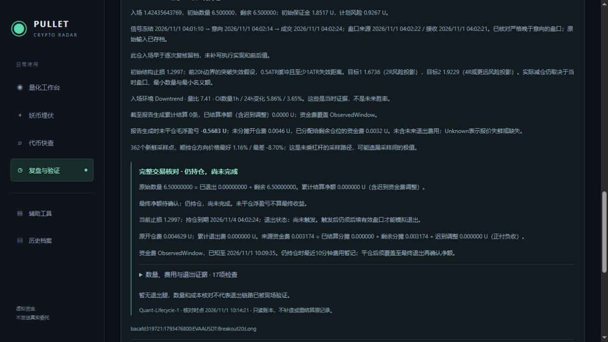

# Quant-Lifecycle-1 完整交易核对验收

2026-11-01，上海时间。已上线[复盘与验证](http://localhost:5218/journal)的“持仓路径 → 完整交易核对”。本轮只读原账本并增加日报字段，不修改开仓、止盈止损、杠杆或风险参数，不发送委托、不强制退出。

## 核对内容

- 原始数量 = 累计退出数量 + 剩余数量；原始保证金按数量分摊守恒。
- 当前抵押额 = 剩余原始保证金 − 分配给剩余仓位的资金费；负资金费表示收取。
- 原开仓费 = 已退出分摊 + 剩余开仓费。保存的退出价、数量和退出费须与当时成本资料一致，不用当前费率追补历史。
- 每一退出腿分别检查方向、实际价差毛额和扣费净额，防止两腿相反的误差在总额中抵消。
- 来源资金费 = 已结算分摊 + 剩余仓位分摊 + 迟到已平数量调整；重复同ID只计一次，冲突资料标记不一致。
- 后续退出盘口的来源和接收时间必须严格晚于触发/上次成交，不晚于结算；缺少当时资料明确待补证。
- 仍持仓不能带最终退出标记；已平仓须且仅须最后一腿标记最终退出。

仅已平仓、核验无不一致/资料缺口且资金费观察范围覆盖最终退出，才确认最终净额。它等于已保存结算净额减迟到费用调整，不再重复扣开仓费。状态区分仍持仓、已退出待补资金费、资料不完整、账目不一致、已平仓核对通过。来源范围通过不证明供应方绝无遗漏，也不代表策略盈利或真实撮合。

没有退出腿时，五个退出相关检查显示“尚无退出样本”，不按空集合伪装成现场退出验证通过。剩余仓位同时显示当前止损、持仓到期时间及已锁定退出状态。原每日路径和费用口径保留，原日期报表可继续从本地账本补证。

## 时间一致性修复

现场发现原日报先采集生成时间、再等待账户锁：一次报表生成时间10:11:31.1215675早于所用账户更新时间10:11:31.5749469，使刚完成的资金费检查被视为未来资料。现在在取到账户快照后采集报告时间，并重新确定上海日期。新增确定性测试在恢复快照时推进时钟，验证此竞争条件。未放宽未来资料检查。

## 验证与部署

后端最终全量667项通过：Core96、Scanner100、Integration471，包含14个生命周期用例和日报时间竞争条件测试。覆盖长短两个分批目标后最终退出、费用/数量守恒、部分减仓后迟到资金费的未平/已平分配、负费收取、缺失一腿、相互抵消的净额错误、冲突记录、同触发盘口、缺失历史费用及只读序列化。结果在`TestResults/Lifecycle-2026-11-01/Accepted/`。前端43项通过，最终Vue类型检查和生产构建通过。

隔离只读预览使用TESTUSDT内存测试账户，验证两次目标减仓和一次最终止损的三腿表格、状态、成本及来源时间。它不打开正式数据库，不调用正式执行接口，也不是现场收益。正式页核验EVAA未平仓、无退出腿、资金费与剩余保证金一致；两个页面均无浏览器警告/错误。预览已关闭。见[浏览器记录](Lifecycle-Browser-2026-11-01.json)、[隔离示例](Lifecycle-Fixture-2026-11-01.png)。

10:14:21完成最终发布，服务进程7300、Ready，守护和可见状态窗口正常恢复。配置SHA256保持`8793C20D598AF77C3AC254B5F7D74253B550FEA46C7C5FEB25493A4194626CCE`，月30GB及原代理设置保留。本轮没有数据库结构迁移；业务库保持Schema15。日报通过既有后台每5分钟保存，不增加外部请求，实际归档已包含Lifecycle字段。

10:15:40核验：现金约961.663946U，BTC、NMR、EVAA三笔ID及精确数量与发布前一致；新执行生效时间、完整控制参数保持。五份原始研究/迁移文件SHA256均未变。见[运行记录](Lifecycle-Runtime-2026-11-01.json)、[实际日报](Lifecycle-Report-2026-11-01.json)。

EVAA原始/剩余数量均6.5、退出数量0；原开仓费0.0046291584225U，已入账资金费0.003174424435U，剩余抵押额1.848488944565U。本次核对没有失败或未知项，五项退出检查为无样本，最终净额仍为空。10点小时已冻结60个标的、240个判断，本小时没有新价格候选；此前新模型累计1次开仓、2次旧取消没有被重写。当前不是完整交易验收或盈利验证完成。

下一步继续由行情触发实际新意向或EVAA退出，再用本模块核对全生命周期。首笔自然退出和30～60天前瞻样本仍在推进计划中保持未完成。

