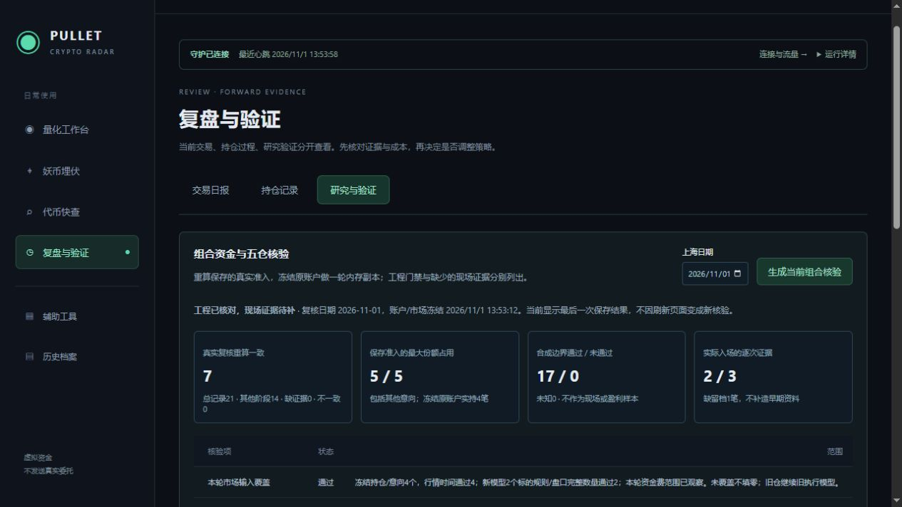

# Quant-Portfolio-Validation-1 组合资金与五仓核验

2026-11-01上海时间13:18:59发布，进程54684，健康状态Ready。13:53:12在正式页面显式生成报告，编号`eb56f44b-c1d1-4c91-a5ab-dcd457cc8821`。入口：[复盘与验证 → 研究与验证](http://localhost:5218/journal?view=research)。四个主导航保留。

本轮完成工程核验及其取证界面。结论为“工程已核对，现场证据待补”，没有将其标为完整历史组合回测或盈利验证通过。原策略、止损止盈、风险预算、自动执行与成本模型保持原版本。

## 范围及方法

按[预登记](Portfolio-Validation-预登记-2026-11-01.md)固定案例和种子选择，不做参数搜索。保存原始复核及其原信号输入，独立重算Intent/Admission，再核对实际采用数量/杠杆/止损、现金及其他意向保证金/费用预留、总保证金、单笔/总/同向/相关风险。历史准入使用当时权益，相关性缺失按原规则计入相关组，旧仓占用组合额度。

生产复核索引查询不设500条摘要上限；全部所选日期、原账户版本/时间范围内的记录参与计数，界面最多列100条并提示截断。Funding、Identity等其他阶段单列，不计为可完整准入重算样本。

复制原账户、全成交/资金费账本、本机市场/交易规则/盘口/资金费缓存，在内存调用原QuantPaperEngine一轮，不调用生产持久化。重复执行、序列化恢复再执行均比较完整输出哈希。冻结K线投影保留原引擎使用的Bars/Hour/Issue，专项测试将其与原生输入直接执行结果对照。

该轮缓存包含522个市场视图、5份相关K线框架；数量表示当时缓存规模，不表示全部合约均具备完整历史。新模型持仓的规则/盘口须覆盖原数量，旧仓继续原执行模型；输入覆盖另设门槛，缺失保持Unknown。

## 正式冻结结果

| 项目 | 结果 |
|---|---|
| 所选日保存复核 | 21条 |
| 准入完整重算一致 | 7条，不一致0条、约束违规0条 |
| 其他阶段单列 | 14条，不混作通过样本 |
| 保存准入最大份额占用 | 5份，包含其他意向 |
| 冻结原账户 | 实持4笔，意向0笔 |
| 当日新模型实际入场证据 | 3笔中关联2笔；早期EVAA缺逐次复核档案 |
| 本轮输入覆盖 | 4个持仓行情通过；2个新模型标的规则/盘口数量通过，资金费范围已观察 |
| 单轮副本 | 重复/恢复结果一致，源对象保持 |
| 副本新增 | 退出0条，资金费入账0条，新仓0个 |
| 合成边界 | 17项通过，失败0项，未知0项 |

原账户冻结时现金951.586895936712U，原保证金41.40619231256925U，计划风险13.367560731181682U，可信权益989.6321309646843U。副本同轮没有新增交易，不能将此静态截面用作独立收益样本。

17项合成案例覆盖原准入、四占用后的第五笔、五占用拦第六笔、意向占额、同向三笔、同币、总风险和相关未知额度、四份大保证金、低现金、其他意向保证金及费用预留、缺权益/标记价/盘口/费用观察、压力环境、回撤不加风险。它们修改隔离准入字段，验证门禁，不声明每个构造组合都存在完整可交易的连续账户路径。种子为当日最新Filled/Admission；若损坏或缺证据，保持未知，不回退挑选更有利种子。

三项门槛仍为Unknown：早期入场留档覆盖、五笔实际持仓现场、完整历史连续市场回放。没有补造旧资料，也没有为凑五仓强行开仓。实际分批/尾仓、更多完整自然退出、跨日和30～60天前瞻证据继续积累。

## 存档与数据保留

新档案位于`artifacts/win-x64/Data/QuantPortfolioValidation/`：内容寻址的Sources、不可覆盖的Runs，以及最后报告索引latest。写入采用临时文件/原子移动；读取核对内容哈希并以冻结来源重新执行，压缩和解压均有限额。读取已保存结果不补下载或重新生成当前账户报告。页面每60秒只读结果，生成须显式操作。

正式档案及21份来源共1,467,740字节压缩资料。独立进程只读取该目录重新执行成功，完整run哈希为`affbabe8e749a5be9a2b156f0ff71cb279276529d9705ae428fd65a972f4e844`；输入哈希`336c4e607d4cf63496b66da52fe0d65a4171a955961a027256f52af3a331acfc`，副本输出哈希`ae47512899cbfb20a305700c49e6c0c311c92e35665e641b9f44a04e528bdfaf`。

发布前正常排空停止并备份数据库/配置；表结构保持16。恢复后原现金、4笔持仓数量、执行控制保持，原成交/资金费Payload逐条一致，原97条净值样本全部保持（核对时已有132条，新增为正常运行采样）。121份冻结资料及5份研究/迁移档案SHA256保持。月30GB/日900MB配置及配置文件SHA256保持；本模块只用本机缓存，无新增供应方采集。未推送Git。

## 验证与异常记录

- 最终后端756项通过：Core96、Scanner100、Integration560；本模块18项专项纳入其中。结果目录为`TestResults/PortfolioValidation-2026-11-01/Final-Accepted/`。
- 专项覆盖五仓3多2空守恒、5笔正负资金费分配/重跑不重扣、5笔同时风险退出释放抵押并计费、保留负现金缺口、缺盘口保留风险仓、独立复算/篡改拒绝、105条计数/100条展示、601条SQLite索引和生产持久化零调用。五仓构造均为工程测试。
- 前端43项通过，Vue类型检查及生产构建通过。正式页面生成后检查17项明细、报告日期/范围和空结果状态；控制台无警告/错误。格式错误和未来日期请求均返回400。
- 专项中曾有一次测试进程`System.AccessViolationException`，调用栈涉及.NET原生ASCII编码搜索/JSON序列化，记录保留在`TestResults/PortfolioValidation-2026-11-01/Targeted-Final/`。出错的105条案例单独重跑、18项专项及后续全量测试均通过；未更改JIT/编码器开关。根因尚未定位，不能将重跑通过视为已修复；未观察到正式服务发生同次崩溃，长期稳定性仍需继续观察。

证据文件：[正式报告](Portfolio-Validation-Report-2026-11-01.json)、[独立档案重放](Portfolio-Validation-Archive-Replay-2026-11-01.json)、[运行核对](Portfolio-Validation-Runtime-2026-11-01.json)、[账本保留](Portfolio-Validation-Preservation-2026-11-01.json)、[冻结资料保留](Portfolio-Validation-Frozen-Preservation-2026-11-01.json)、[浏览器记录](Portfolio-Validation-Browser-2026-11-01.json)、[综合核验](Portfolio-Validation-Validation-2026-11-01.json)。

本轮开发与发布验收完成后结束，服务器继续自动采集和模拟执行。后续以自然持仓/退出及保存的完整市场输入补足连续组合证据，仍按原计划积累样本再评审策略。
