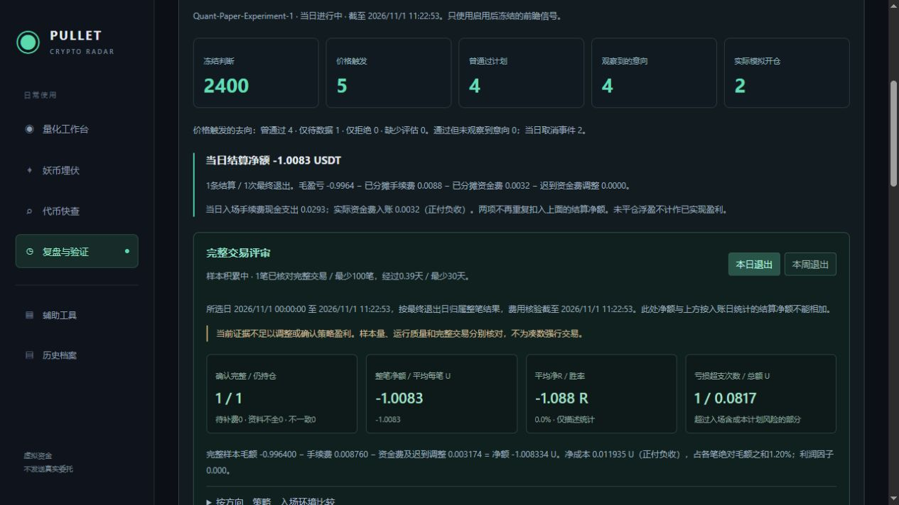
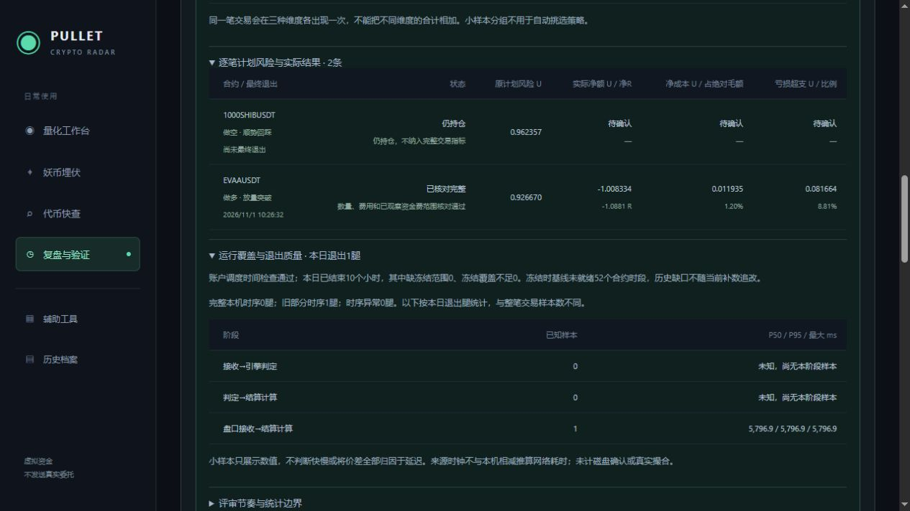

# Quant-Review-1 完整交易与运行质量评审

2026-11-01，上海时间。11:22:54发布到[复盘与验证](http://localhost:5218/journal)的现有交易日报，增加“完整交易评审”，保留四个主入口。报告随原后台每5分钟持久保存，不新增外部请求，不修改冻结策略、风险、执行规则或账户本金。

## 完整交易口径

只读当前启用版本、规则哈希和生效后的原始账本，不混入旧BTC/NMR仓位或价格回放。每个PositionId只算一笔交易，目标1、目标2、最终退出仍是同一笔。只有生命周期Complete且计划风险有效才进入确认完整指标；未平仓、已退出待补资金费、资料不完整、账目不一致分别展示，净结果保留待确认。

指标直接使用完整账本，独立于每日路径最多30笔的显示限制。逐笔评审表最多100笔并明确截断，上方指标和分组不随截断少算。重复相同退出ID只计一次，冲突/数量缺口由生命周期检查排除，不能用最终退出标记冒充完整数量。

“本日退出”“本周退出”以最终退出日归属整笔损益，周一00:00至下周一00:00按上海时间。包含截至报告生成已知的迟到资金费；旧报告日期查询也是按当前已知资料补证，并不声称是当时已知。日报上方原当日结算仍按结算/费用入账日列示，这两种统计不能相加。未平仓列表表示报告生成时仍持有且曾参与所选日/周，不伪装成历史日末持仓快照。

## 风险、成本与分组

- 净R = 完整交易实际净额 / 成交时保存的含成本计划风险；不是保证金收益率或账户日收益率。
- 亏损超支 = max(0,实际净亏损−计划风险)，同时展示金额和占计划风险比例。
- 净成本 = 双边手续费 + 有符号实际资金费及迟到已平数量调整，正付负收；不能再次重复扣入账时已经分摊的开仓费。
- 单笔成本占比以该笔绝对毛额为分母，汇总以各笔毛额绝对值之和为分母，避免正负毛额相抵导致误读。零毛额保留未知。
- 利润因子 = 完整交易净盈利之和 / 净亏损绝对值之和；无亏损样本不显示无穷大，无完整样本的均值、胜率和R保持未知。
- 按方向、策略、原批准意向的环境分别分组。每种维度各自守恒，同一交易在三个维度会各出现一次，维度合计不能相加。原批准环境不冒充后来重新采集的市场标签。

现场只有EVAA一笔完整新模型交易：净额-1.008334411345U、-1.0881263992R；原计划风险0.92667029499U，超支0.08166411636U、8.81264%；净成本0.011934541345U，占绝对毛额约1.19777%。胜率0%、利润因子0只是这一笔结果，不是长期结论。

1000SHIB仍持仓，计划风险0.9623565445095U；实际净额、R、成本占比和超支保持待确认，不把浮盈/浮亏或分批暂记当作整笔最终表现。

## 每日运行检查和每周评审

现有日报汇总账户更新时间、已结束小时的冻结范围/覆盖不足、冻结时基线未就绪数量；历史基线缺口不因后续补数被追改。本轮现场已结束10个小时，冻结范围/覆盖不足均0，历史冻结基线未就绪52个合约时段。这里只说明调度时间及冻结覆盖，不能据此断言所有外部数据无缺失。

退出质量按当日退出腿列出完整本机时序、旧部分时序、异常数量，各阶段已知样本的P50/P95/最大值使用最近秩定义。EVAA为旧部分时序，判定相关两阶段仍是0个已知样本/未知；盘口接收到旧账本轮次5796.9ms保留为部分资料，不据单样本判断快慢或将全部价差归因于延迟，也未计磁盘确认和真实撮合。

每天先看运行、资料与账目，再看成本和超支。每周一选择上周日的日报日期，切换“本周退出”检查上周结果。后台保存日报及其周汇总；没有创建外部通知或自动调参任务。

按原推进计划建议，至少经过30日、尽量100笔完整交易才进入第一轮评审，通常仍需30～60日/100～200笔。页面累计已确认完整样本和经过时长；门槛达到只显示“需人工评审”，不会标为盈利通过。成本压力、集中度、跨窗口一致性和不确定性仍需后续证据。存在记账不一致、缺资料、失鲜或时序异常先核查资料。当前状态Collecting，只有1笔完整交易。

## 验证与保留

后端全量694项通过：Core96、Scanner100、Integration498；前端43项、Vue类型检查和最终生产构建通过。结果在`TestResults/QuantReview-2026-11-01/Final/`。新13个测试覆盖多空费用/R、分批未平排除、待补费/数量不完整排除、迟到负资金费、上海午夜/周一边界、105笔指标与30/100显示限制、旧版本/未来记录排除、零分母、分组守恒、旧时序未知及最低门槛只请求评审。

浏览器验证了日/周切换、下行环境分组、EVAA超支明细和1000SHIB待确认、历史时序未知。隔离内存样例验证3次退出只计1笔完整交易、无亏损利润因子未定义、3腿时序与整笔数分开；不打开正式数据库，不作为现场收益。正式和隔离页面均无浏览器警告/错误，隔离预览已关闭。见[浏览器核验](Quant-Review-Browser-2026-11-01.json)。

发布后进程58052，Ready，原守护和可见状态窗口恢复；现金952.625652175272U、BTC/NMR/1000SHIB三笔精确ID/数量、原启用时间及控制参数保持。5份较早研究/迁移档案和121份10点冻结资料保持；配置SHA256仍为`8793C20D598AF77C3AC254B5F7D74253B550FEA46C7C5FEB25493A4194626CCE`，月30GB预算保留。无数据库结构迁移，业务库Schema15。实际后台日报已保存Review字段。

证据：[运行核验](Quant-Review-Runtime-2026-11-01.json)、[实际日报](Quant-Review-Report-2026-11-01.json)、[测试与归档核验](Quant-Review-Validation-2026-11-01.json)。

尚未完成：更多自然完整交易、实际分批/尾仓、新退出计时的现场样本，以及30～60天前瞻盈利评审。未计算缺少日初净值的账户日收益率或全账户回撤，不强行交易凑样本。本轮开发与发布验收完成后停止，服务器继续自动采集和模拟执行。

