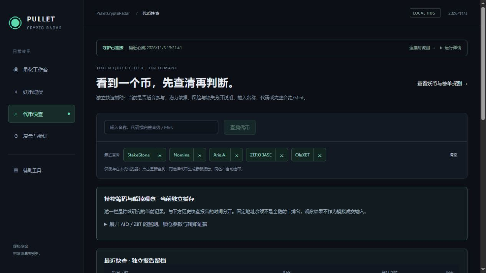

# 代币快查最近查询 · 2026-11-03

搜索框下方的固定 AIO / ZBT 示例已换为最近查询，最多保留五个成功找到候选的关键词。重复搜索按最近使用排序，支持逐条删除和清空。记录保存在当前浏览器 localStorage，刷新或重新进入页面后保留，不跨浏览器同步。

首次使用从已有快查报告中的项目名称补入记录；已有本机记录（包括用户清空后的空列表）优先，不会刷新后再次补入。损坏或不可读的浏览器缓存不阻断搜索，无法持久保存时在页面提示。名称和代码不区分大小写去重，Solana Mint 保持原始大小写及完整内容。

点击记录只重新查找候选，仍需用户确认具体项目、链及交易对后生成分析，沿用现有服务端一分钟内报告复用及流量冷却。缓存不保存行情或分析结论，不自动选择同名币，不加入模拟交易，也不增加外部轮询。删除关键词不删除历史快查报告。

## 验证

前端 14 个测试文件共 47 项通过，类型检查和生产构建通过。新增验证覆盖五条限额、重复置顶、Mint 大小写、持久化读取、清空标记及坏缓存。浏览器实测重复查询、单条删除后刷新、清空后刷新、历史报告保留均通过，无控制台告警或错误；测试后恢复原先五个近期项目。

仅更新运行目录的网页资源，PID 16296、会话及模拟策略不变。431 个非网页部署文件摘要一致。上一观察基线的 797 条账目记录全部保留，缺失/改写为零，已知数值核对失败为零。

网页摘要变化按实留在上一观察记录中；原基线未改写。新固定发布观察为上海时间 **11 月 3 日 13:22:06 至 11 月 4 日 13:22:06**，位于 `artifacts/simulation-observation-20261103-token-recents`，默认指针已更新。模拟服务持续运行，原生异常、数据缺口和盈利评审保持原有待核查状态。

同名目录保存 Deployment.json、Health.json、Browser.json、Validation.json、Previous-Observation-Check.json 及页面截图。网页入口备份位于 `artifacts/token-recent-queries-20261103`，旧散列资源保留供已打开的页面继续使用。

