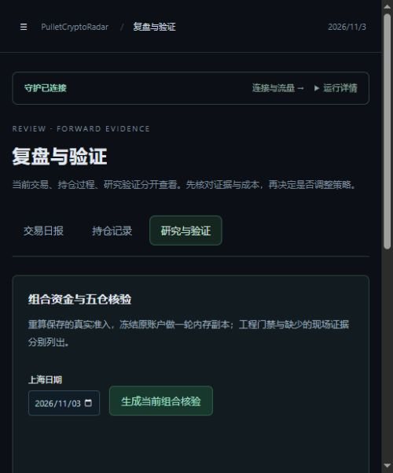

# 旧版界面移除记录 · 2026-11-03

按用户截图及“跟原版本相关的移除”要求，移除网页中的原版本账户、分析记录、最近结算、原执行累计表现、规则贡献对照和迁移演练。侧栏与工作台、复盘、辅助工具、执行费用、固定规则研究页中的相关入口同步删除。

旧路径 `/archive`（包括原查询参数）、`/forward`、`/strategy-replay`、`/strategy-research`、`/volatility`、`/evaluation` 全部转到当前 `/journal`，不再加载早期研究页面。删除 Archive、LegacyAccount、QuantRehearsal、PageContext 四个界面组件。当前策略表现只展示 Quant 分组，不回退显示早期策略。

历史成交、持仓过程、费用、账户净值和存量仓位管理保持原样。复盘中的全账户按日结算和持仓记录仍可查询；成本核对保留必要的历史费用与估值说明，防止误读现有余额。底层历史研究资料及接口未删除，当前妖币埋伏、代币快查和固定规则研究继续使用。

## 验证与部署

- 前端 13 个测试文件共 43 项通过，Vue 类型检查与生产构建通过。构建不再包含旧页面模块。
- 浏览器核验 6 个旧路径均转到当前复盘，无原版本分析/结算区块；持仓过程与全账户结算仍可见。浏览器告警和错误为零。
- 仅热更新 `artifacts/win-x64/wwwroot`，没有重启服务，PID 16296、会话 `27ecf646e84846b582f7aaa2cbf82fd2` 保持。发布前后 431 个非网页部署文件摘要一致；不修改 Data、Logs 或策略配置。
- 原观察基线中的 632 条业务记录全部保留，缺失/改写为零。期间已知账目差额失败为零，13 条因缺报价无法核对仍保留 Unknown，不改写历史结果。
- 旧网页入口文件备份于 `artifacts/ui-legacy-removal-20261103`。旧散列资源暂保留供已打开的页面继续加载，刷新后使用新入口与新路由。

## 观察窗口

固定发布验收包含网页文件摘要，因此本次界面发布后，原 10:37 基线的“发布文件”项按实记录 Fail，原因是授权的网页更新，不能宣称同一发布版本连续不变。原目录 `artifacts/simulation-observation-20261103` 和全部数据保留，未篡改基线。

新基线为上海时间 **11 月 3 日 13:16:46 至 11 月 4 日 13:16:46**，目录 `artifacts/simulation-observation-20261103-ui-cleanup`；默认观察指针已更新。模拟交易与心跳采集继续，不合并两次窗口冒充连续固定版本验收。

新基线初查为 Collecting，发布文件、配置、规则、原账本、当前服务与守护均通过。开始数秒时没有新的分钟采样，采样及账目核对暂为 Unknown；已知原生异常和策略盈利也仍待补证。此次不调整策略或启用真实资金。

证据位于同名目录的 Deployment.json、Health.json、Browser.json、Previous-Observation-Check.json、New-Observation-Check.json、Validation.json 和 Journal-Viewport.png。

